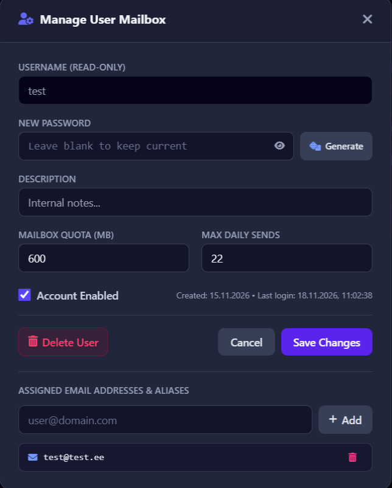

# lsMailServer

A lightweight cross-platform mail server written in C#/.NET that provides SMTP, POP3, and IMAP services with modern authentication, TLS encryption, internationalization support, and standards-compliant protocol extensions. The platform includes a REST API for server administration and a web-based management interface for managing domains, users, mailboxes, and server configuration.

## Status

> [!WARNING]
> **Beta Release**
>
> The project is currently in beta. Core mail services, REST API management, and the Web Administration UI are fully functional. Some monitoring and administration features are still under development.

## Quick Start

> [!IMPORTANT]
> Before running **lsMailServer**, review and update the configuration in:
>
> `Data\appsettings.json`

### Default Endpoints

- **Web Administration UI:** `http://localhost:5000`
- **REST API Swagger:** `http://localhost:5000/swagger`
- **SMTP:** `25`
- **POP3:** `110`
- **POP3S:** `995`
- **IMAP:** `143`
- **IMAPS:** `993`

> [!NOTE]
> The Web Administration UI and REST API are hosted by the same service.
>
> All service bindings, listening ports, TLS certificates, protocol settings, Web Administration UI credentials, and REST API authentication settings are configurable through `Data\appsettings.json`.

## Screenshots

### Login

### Domain Management

### User List

### User Management

## Supported Features

### Administration & Management

Manage the entire mail server through a modern REST API and web-based administration interface.

#### Available

- **REST API** for programmatic administration and automation.
- **Web Administration UI** built on top of the REST API.
- **Domain Management** for creating, updating, and removing hosted mail domains.
- **User & Mailbox Management** for managing users, passwords, aliases, and mailboxes.
- **Automation Friendly** architecture for provisioning and integration with external systems.

#### Planned (Beta Roadmap)

- **Session Monitoring** for active SMTP, POP3, and IMAP client connections.
- **Relay Queue Monitoring** for outbound message tracking and delivery status.
- **System Settings Management** through the Web Administration UI.

### SMTP Server

Reliable mail transport with support for secure connections, modern client compatibility, and enhanced message handling.

- **STARTTLS**
- **AUTH PLAIN / LOGIN**
- **SMTPUTF8**
- **SIZE**
- **DSN** (Delivery Status Notifications)
- **CHUNKING**
- **8BITMIME**
- **ENHANCEDSTATUSCODES**

### SMTP Relay

Flexible outbound message delivery options for self-hosted and production environments.

- **Direct MX Delivery** using DNS MX record lookups.
- **Smart Host Relay** support.

### POP3 Server

Simple and efficient mailbox access for legacy and lightweight email clients.

- **STLS**
- **SASL PLAIN / LOGIN**
- **TOP**
- **USER**
- **UIDL**

### IMAP Server

Full-featured mailbox management with modern synchronization and IMAP extensions.

- **IMAP4rev2**
- **STARTTLS**
- **AUTH PLAIN / LOGIN**
- **SASL-IR**
- **NAMESPACE**
- **QUOTA**
- **IDLE**
- **ENABLE**
- **UTF8=ACCEPT**
- **UIDPLUS**

### Deployment & Operation

The current beta release can be run either as a standalone console application or as a Windows service.

- **Standalone Execution** using `lsMailServer.exe`
- **Live Console Logging** with real-time protocol activity, diagnostics, warnings, and error reporting
- **Windows Service Installation** using `_windows-install.bat`
- **Windows Service Removal** using `_windows-uninstall.bat`
- **Cross-Platform Core** built on .NET

## Typical Use Cases

- Self-hosted mail server deployments
- Small business email infrastructure
- Development and test environments
- Email protocol learning and experimentation
- Automated user and domain provisioning through the REST API
- Integration with custom applications and management platforms

## License

See the repository license for details.