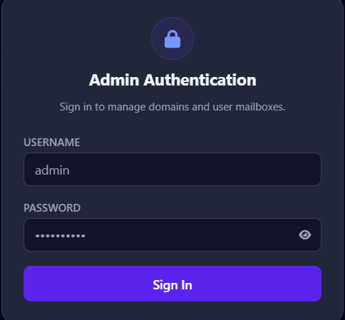
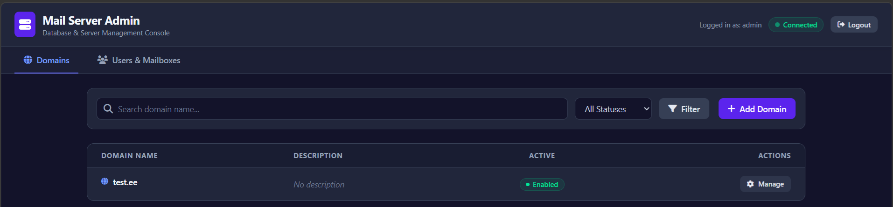
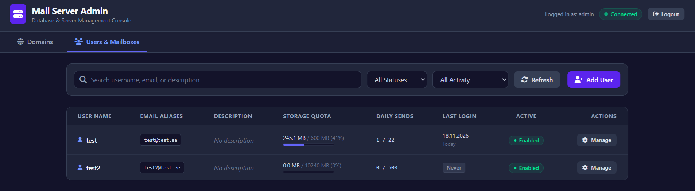

# lsMailServer

A lightweight cross-platform mail server written in C#/.NET that provides SMTP, POP3, and IMAP services with modern authentication, TLS encryption, configurable sender validation, DKIM signing and verification, internationalization support, and standards-compliant protocol extensions. The platform includes a REST API for server administration, a web-based management interface, and Docker container support for simplified deployment.

## Status

> [!NOTE]
> **Beta Release**
>
> lsMailServer is currently in beta and under active development. Core mail services, SMTP relay functionality, REST API management, and the Web Administration UI are fully operational.

## Quick Start

> [!IMPORTANT]
> Before running **lsMailServer**, review and update the configuration in:
>
> `Data\appsettings.json`

### Default Endpoints

- **Web Administration UI:** `https://localhost:5001`
  - Default Password: `1234`
- **REST API Swagger:** `https://localhost:5001/swagger`
- **SMTP:** `25`
- **POP3:** `110`
- **POP3S:** `995`
- **IMAP:** `143`
- **IMAPS:** `993`

> [!WARNING]
> Change the default Web Administration password before exposing the server to untrusted networks or production environments.

> [!NOTE]
> The Web Administration UI and REST API are hosted by the same service.
>
> All service bindings, listening ports, TLS certificates, protocol settings, Web Administration UI credentials, and REST API authentication settings are configurable through `Data\appsettings.json`.

## Docker

Official Docker image:

```bash
docker pull ivx675/lsmailserver:latest
```

Run the container:

```bash
docker run -d \
  --name lsmailserver \
  -p 25:25 \
  -p 110:110 \
  -p 143:143 \
  -p 995:995 \
  -p 993:993 \
  -p 5001:5001 \
  ivx675/lsmailserver:latest
```

Docker Hub:

https://hub.docker.com/r/ivx675/lsmailserver

## Screenshots

### Login



### Domain Management



### User List



### User Management


## Supported Features

### Administration & Management

Manage the entire mail server through a modern REST API and web-based administration interface.

- **REST API** for programmatic administration and automation.
- **Web Administration UI** built on top of the REST API.
- **Domain Management** for creating, updating, and removing hosted mail domains.
- **User & Mailbox Management** for managing users, passwords, aliases, and mailboxes.
- **System Settings Management** through the Web Administration UI.
- **Automation Friendly** architecture for provisioning and integration with external systems.

### Monitoring & Diagnostics

Built-in tools for monitoring server activity and troubleshooting issues.

- **Session Monitoring** for active SMTP, POP3, and IMAP client connections.
- **Relay Queue Monitoring** for outbound message tracking and delivery status.
- **Live Log Viewer** for real-time in-memory log monitoring.
- **Persistent Error & Warning Logs** for auditing and troubleshooting.

### SMTP Server

Reliable mail transport with support for secure connections, modern client compatibility, sender validation, message authentication verification, and enhanced message handling.

- **STARTTLS**
- **AUTH PLAIN / LOGIN**
- **SMTPUTF8**
- **SIZE**
- **DSN** (Delivery Status Notifications)
- **CHUNKING**
- **8BITMIME**
- **ENHANCEDSTATUSCODES**
- **DKIM Signature Verification**
- **Sender Validation** - Configurable sender verification using a fallback validation chain:
  - SPF → MX → Domain IP
  - Validation succeeds when any verification method successfully verifies the sender domain.

### SMTP Relay

Flexible outbound message delivery options for self-hosted and hosted environments.

- **Direct MX Delivery** using DNS MX record lookups.
- **Smart Host Relay** support.
- **DKIM Signing**
- **Configurable DKIM Settings**

### POP3 Server

Simple and efficient mailbox access for legacy and lightweight email clients.

- **STLS**
- **SASL PLAIN / LOGIN**
- **TOP**
- **USER**
- **UIDL**

### IMAP Server

Full-featured mailbox management with modern synchronization and IMAP extensions.

- **IMAP4rev2**
- **STARTTLS**
- **AUTH PLAIN / LOGIN**
- **SASL-IR**
- **NAMESPACE**
- **QUOTA**
- **IDLE**
- **ENABLE**
- **UTF8=ACCEPT**
- **UIDPLUS**

### Deployment & Operation

The current beta release can be run as a standalone console application, Windows service, or Docker container.

- **Standalone Execution** using `lsMailServer.exe`
- **Live Console Logging** with real-time protocol activity, diagnostics, warnings, and error reporting
- **Windows Service Installation** using `_windows-install.bat`
- **Windows Service Removal** using `_windows-uninstall.bat`
- **Docker Container Support** using the official Docker image
- **Cross-Platform Core** built on .NET

## Typical Use Cases

- Self-hosted mail server deployments
- Small business email infrastructure
- Development and test environments
- Email protocol learning and experimentation
- Automated user and domain provisioning through the REST API
- Integration with custom applications and management platforms

## Source Code

- GitHub Repository: https://github.com/ivx675/lsMailServer
- Docker Hub: https://hub.docker.com/r/ivx675/lsmailserver

## License

See the repository license for details.